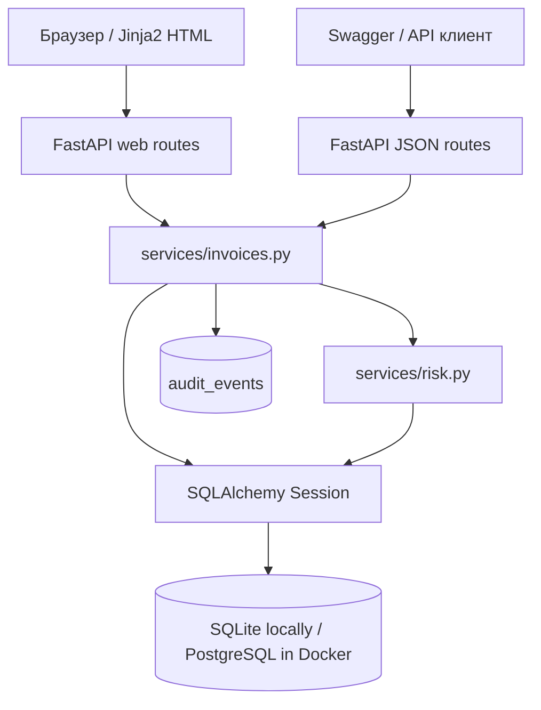
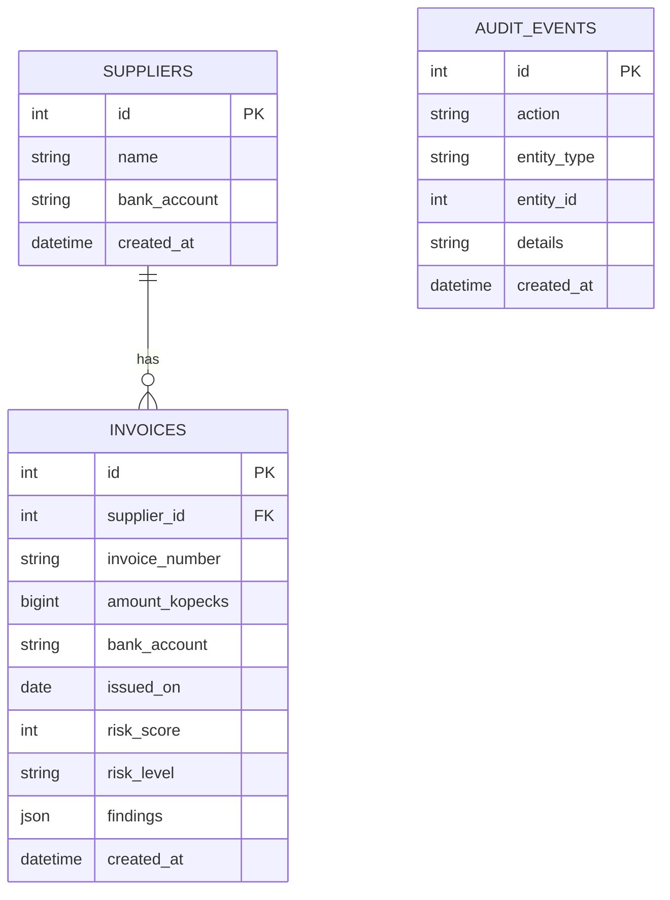

> **Архивный документ v0.1:** описывает исходную архитектуру. Для изменений безопасности в v0.2 см. [SECURITY_MODEL.md](SECURITY_MODEL.md) и [CHANGELOG.md](CHANGELOG.md).

# Архитектура InvoiceShield v0.1.0

## Границы слоёв

- `routes_web.py`: обработка HTML-форм, редиректы, страницы.
- `routes_api.py`: типизированные REST маршруты, HTTP-коды ошибок.
- `schemas.py`: Pydantic-валидация входа, сериализация ответа.
- `services/invoices.py`: бизнес-операции, транзакции, журнал.
- `services/risk.py`: чистая бизнес-логика правил с чтением существующих счетов.
- `models.py`: SQLAlchemy-таблицы, суммы в целых копейках.
- `database.py`: подключение, жизненный цикл сессий.
- `main.py`: запуск и сборка компонентов.

## Схема таблиц

## Поток проверки

1. HTTP-запрос проходит Pydantic-валидацию.
2. Сервис получает поставщика по ID.
3. Risk Engine сопоставляет реквизиты, проверяет ранее сохранённые номера, размер платежа.
4. Сервис сохраняет счёт и событие одной транзакцией БД.
5. API возвращает расчёт с перечнем объяснений, UI показывает предупреждения.

## Начальная модель угроз (draft)

- **Подмена реквизитов:** автоматическое сравнение с эталоном; однако сам эталон требует контроля доступа в будущей версии.
- **Повторные счета:** обнаружение не блокирует сохранение, чтобы можно было расследовать повтор.
- **Несанкционированный доступ:** пока не закрыт; отсутствие auth — причина запрета публичного развёртывания.
- **Ошибки в суммах:** `Decimal` + целые копейки, вместо двоичных `float`.
- **Утечка данных через журнал:** журнал хранит только тип действия, ID, уровень риска; не пишет банковские реквизиты.
- **SQL injection:** ORM выражения с параметризацией, без SQL-сборки из пользовательских строк.
- **XSS:** Jinja2 HTML-экранирование; не вставляем произвольные HTML-фрагменты.
- **CSRF:** в первой версии отсутствует, формы только для localhost. В дальнейшем обязательна защита сессий и CSRF.

## Источник security checklist

OWASP ASVS v5.0.0: https://asvs.owasp.org/

## Дополнение v0.3.0 — расследования

- `Invoice` (1) → `Incident` (0..1) по уникальному `invoice_id`. Для `LOW` кейс не создаётся, для `MEDIUM/HIGH` создаётся автоматически в транзакции проверки.
- `Incident` (1) → `IncidentEvent` (много). Записи истории по API добавляются, но не изменяются; это не криптографический audit trail.
- `Incident` (0..1) → `User` как назначенный исполнитель.
- Пользовательский интерфейс: `/incidents` и `/incidents/{id}`; API: `/api/incidents` и подмаршруты управления.
- Роли: `admin` может назначать; `analyst` может менять статусы и комментировать; оба должны войти и передать CSRF-токен на записи.
- Одновременная работа: optimistic locking по `version`; устаревший запрос отклоняется с HTTP 409. Дальнейшее развитие: Alembic, очередь задач, уведомления, строгая tenant isolation.
